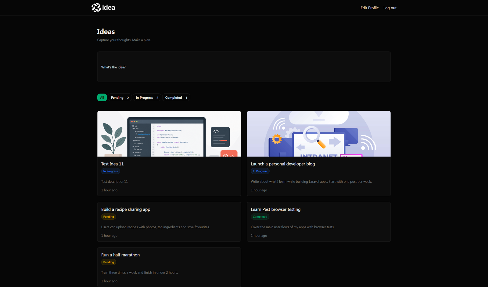
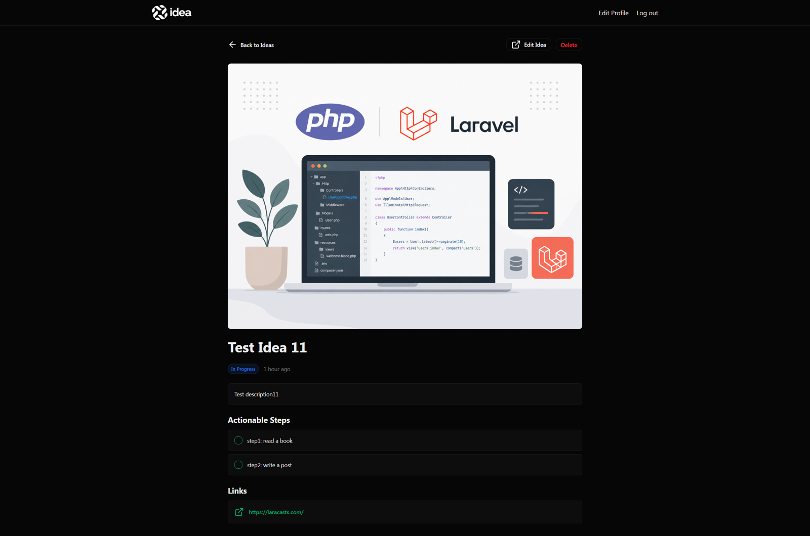

# Idea

A Laravel app for capturing ideas and turning them into actionable steps.
Track each idea's status, attach links and a featured image, and tick off steps as you make progress.

**Live demo:** https://idea-production-i95n1d.laravel.cloud

| Email | Password |
|-------|----------|
| `demo@example.com` | `password` |

> The app scales to zero when idle, so the first request may take a few seconds to wake it up.



<details>
<summary>More screenshots</summary>



</details>

---

## Features

- **Authentication**: registration, login, logout and profile editing (name, email, password)
- **Ideas**: create, edit and delete ideas from a modal form
- **Status tracking**: Pending, In Progress or Completed, with filter pills that show a count per status
- **Actionable steps**: break an idea into steps and toggle each one as completed
- **Links**: attach one or more reference links to an idea
- **Featured images**: upload, replace or remove an image per idea
- **Authorization**: users only ever see and change their own ideas and steps
- **Notifications**: the previous email address is notified when a user changes it

## Tech stack

| Layer | Technology |
|-------|------------|
| Backend | PHP 8.4, Laravel 13 |
| Frontend | Blade components, Tailwind CSS v4, Alpine.js, Vite |
| Database | SQLite (local), MySQL (production) |
| Storage | Local `public` disk (local), Laravel Object Storage / Cloudflare R2 (production) |
| Testing | Pest 4, including browser tests with Playwright |
| Hosting | Laravel Cloud, with push-to-deploy from `main` |

## Architecture notes

- **Action classes** (`app/Actions/CreateIdea`, `UpdateIdea`) hold the create and update logic, so controllers stay thin. An idea and its steps are written inside a single database transaction.
- **Form Requests** (`StoreIdeaRequest`, `UpdateIdeaRequest`) validate input before it reaches the controller.
- **Policies**: `IdeaPolicy::workWith` is the single ownership rule. Steps reuse it through their parent idea instead of duplicating it.
- **Enum** `IdeaStatus` is a backed enum cast on the model, with labels and the list of valid values for filtering.
- **Environment-driven storage**: the code stores images on the *default* disk and resolves URLs through an `image_url` accessor. The same code writes to the local disk in development and to an object storage bucket in production. Only `FILESYSTEM_DISK` changes.
- **Database-agnostic models**: explicit casts (booleans, JSON, enum) and model-level defaults, so behaviour is identical on SQLite and MySQL.
- **Idempotent demo seeder**: `DemoSeeder` can run on every deploy without duplicating data, and resets the demo account.

## Getting started

Requirements: PHP 8.3+, Composer, Node.js 22+.

```bash
git clone https://github.com/koutsavlis/idea-app.git
cd idea-app

composer run setup          # install dependencies, create .env, generate key, migrate, build assets
php artisan storage:link    # make uploaded images publicly accessible
php artisan db:seed         # create the demo user and sample ideas

composer run dev            # start the server, queue worker and Vite
```

Then open http://localhost:8000 and log in with the demo credentials above.

## Running tests

```bash
npx playwright install      # once, for the browser tests
php artisan test
```

## Deployment

The app runs on [Laravel Cloud](https://cloud.laravel.com). Every push to `main` triggers a deployment.

- **Build:** `composer install --no-dev --optimize-autoloader`, `npm ci`, `npm run build`
- **Deploy:** `php artisan migrate --force --seed`
- **Resources:** a MySQL database and a public object storage bucket attached as the default disk. Cloud injects their connection details as environment variables.

## Credits and what I added

The app was built following [Laravel From Scratch (2026 Edition)](https://laracasts.com/series/laravel-from-scratch-2026) by Jeffrey Way on Laracasts.

On top of the course project I:

- Deployed it to **Laravel Cloud** instead of Forge, which meant moving image storage from the local disk to an **object storage bucket** behind an environment-driven disk
- Fixed **SQLite-only behaviour** that broke on MySQL: a JSON column default and a missing boolean cast
- Closed an **authorization gap** on step updates and covered it with feature tests
- Added an **idempotent demo seeder** for the live demo
- Ran `composer audit` and patched **26 security advisories** in production dependencies
- Fixed invalid CSS that only failed in the production build, and cleaned up dead code

## Roadmap

- Delete orphaned image files when an image is replaced or an idea is deleted
- Resize and optimise uploaded images in a queued job
- Apply the Rector configuration after reviewing its changes
- Team support, so ideas can be shared between users
